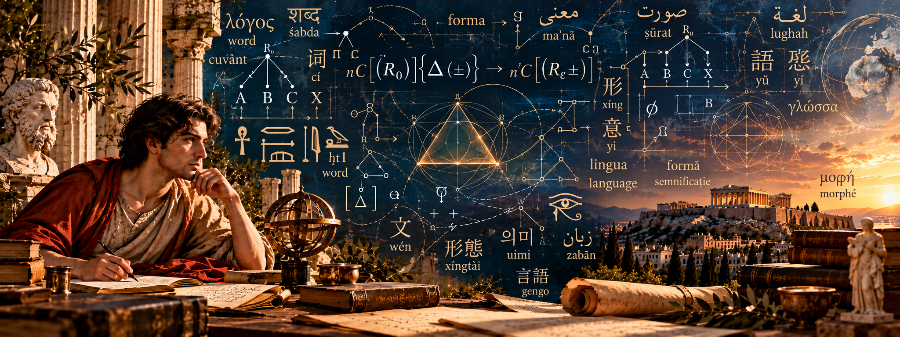
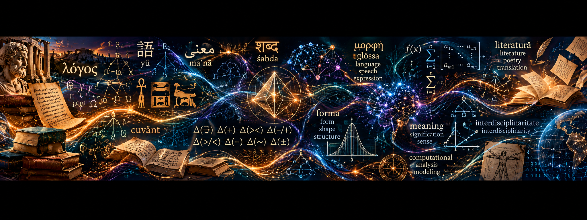
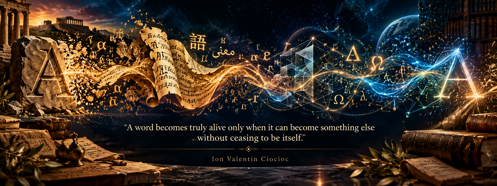

# Ion Valentin Ciocioc

### Linguistics, Literature & Interdisciplinary Research | Athens, Greece
**Theoretical Linguistics · Morphology · Literature · Formal Systems · Computational Research**

---

## About Me

My academic interests lie at the intersection of language, literature, philosophy, and formal thought. I am particularly drawn to questions of transformation, structure, identity, and the ways in which meaning emerges, evolves, and persists across different forms of expression.

My work brings together theoretical inquiry, analytical reasoning, and creative exploration, seeking connections between disciplines that are often studied separately.

Based in Athens, Greece, I approach research as an ongoing dialogue between established knowledge, new perspectives, and the possibilities that emerge when different fields of thought meet.

---

## Research Interests

- Theoretical linguistics and grammatical transformation
- Morphology and morphosyntax
- Formal and operatorial representation
- Linguistic structures and relational continuity
- Computational approaches to linguistic analysis
- Literary studies, poetry, and translation
- Interdisciplinary approaches to language and meaning

---

## Selected Research Works

### [The Metamorphosis Formula](https://doi.org/10.4236/ojml.2025.152017)

Research exploring grammatical transformation and the relationship between linguistic form, structural change, and continuity.

### The Δ Architecture of Grammatical Transformation

A formal operatorial framework for representing and classifying grammatical transformations through eight Δ regimes, macrostructural and microstructural analysis, and relational diagnostics.

---

## Computational Research

### Δ Architecture – Python Implementation

An experimental computational representation of elements of the Δ architecture, intended to support the exploration and formalization of grammatical transformations.

Explore my repositories for available code, documentation, and future developments.

[Explore My GitHub Repositories](https://github.com/ValentinIon89?tab=repositories)

---

## Literary and Interdisciplinary Work

My broader interests include poetry, literary transformation, translation, and the dialogue between classical and modern forms of expression.

This section will be expanded as additional works and projects become publicly available.

---

## Research Profiles and Academic Identifiers

| Platform | Profile |
|---|---|
| ORCID | [Researcher Identifier](https://orcid.org/0009-0002-5711-5856) |
| Google Scholar | [Publications and Citations](https://scholar.google.com/citations?user=lOeVb7sAAAAJ) |
| Web of Science | [Researcher Profile](https://www.webofscience.com/wos/author/record/KGM-1552-2024) |
| HAL | [Academic Archive](https://cv.hal.science/ion-valentin-ciocioc) |
| Figshare | [Research Outputs](https://figshare.com/authors/Ion_Valentin_Ciocioc/19547848) |
| ResearchGate | [Research Profile](https://www.researchgate.net/profile/Ion-Ciocioc) |
| ScienceOpen | [Academic Profile](https://www.scienceopen.com/user/e386c9ce-c06e-4976-9d34-6bdeccb5311f) |
| Accredible | [Professional Certifications & Digital Credentials](https://www.credential.net/profile/ionvalentinciocioc342140/wallet) |
| ReviewerCredits | [Peer Review Certificate](https://www.reviewercredits.com/certificate-viewer/?uid=REV-TWJNZm5CT2FTQ3dTVHJ0TTZGUTdrQT09) |

---

## GitHub Activity

---

## Research Philosophy

---

*Research at the intersection of language, structure, transformation, and meaning.*
